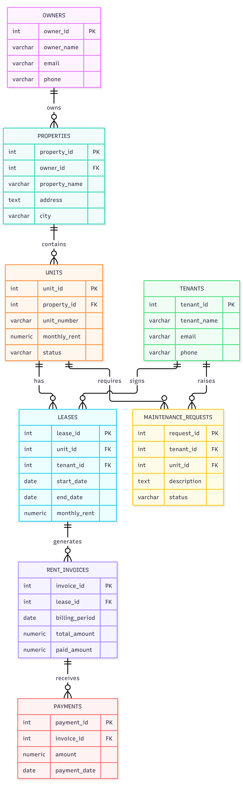

# Real Estate Management System

A PostgreSQL-based database management project designed to manage real estate properties, owners, units, tenants, leases, rent invoices, payments, and maintenance requests.

The project demonstrates practical SQL concepts, database design, data relationships, stored procedures, triggers, views, indexing, and query performance analysis.

## Project Overview

The Real Estate Management System provides a structured way to manage property rental operations through a relational database.

It helps organize property information, track tenant leases, generate monthly rent invoices, record payments, monitor outstanding rent, and manage maintenance requests.

## Technologies Used

- **Database:** PostgreSQL
- **Database Management Tool:** pgAdmin 4
- **Language:** SQL / PLpgSQL
- **Version Control:** Git and GitHub
- **Code Editor:** Visual Studio Code

## Database Structure

The database contains **8 tables** and **3 views**.

### Tables

| Table | Description |
|---|---|
| owners | Stores property owner information |
| properties | Stores property details |
| units | Stores individual property units |
| tenants | Stores tenant information |
| leases | Maintains tenant rental agreements |
| rent_invoices | Stores monthly rent invoices |
| payments | Records rent payments |
| maintenance_requests | Tracks maintenance requests |

### Views

| View | Description |
|---|---|
| property_tenant_details | Displays property and tenant information |
| outstanding_rent_report | Displays pending rent information |
| property_occupancy_report | Provides property occupancy details |

## SQL Concepts Implemented

- Database creation and table management
- Primary keys and foreign keys
- Constraints and data validation
- INSERT, UPDATE, DELETE and SELECT operations
- INNER JOIN and LEFT JOIN
- Subqueries and aggregate functions
- GROUP BY, HAVING and ORDER BY
- Common Table Expressions (CTEs)
- Window functions such as RANK(), DENSE_RANK() and LAG()
- Stored procedures using PL/pgSQL
- Database triggers
- Views
- Indexing and query optimization
- EXPLAIN ANALYZE for performance analysis

## Stored Procedures

The project includes stored procedures for automating database operations, including:

- `generate_monthly_invoices` – Generates monthly rent invoices for eligible leases.
- `record_payment` – Records tenant rent payments.

## Triggers

Triggers are implemented to automate database operations, including:

- Updating invoice payment status after payment changes.
- Updating unit occupancy based on lease operations.
- Automatically updating property modification timestamps.

## Indexing and Performance Analysis

Indexes are created on frequently queried columns to improve data retrieval performance.

`EXPLAIN ANALYZE` is used to examine query execution plans, scan methods, and execution time.

## Entity Relationship Diagram

The database relationships are documented in the ER diagram.



## Project Folder Structure

```text
Real-Estate-Management-System/
│
├── database/
│   ├── 01_create_database.sql
│   ├── 02_create_tables.sql
│   ├── 03_insert_records.sql
│   ├── 04_stored_procedures.sql
│   ├── 05_triggers.sql
│   ├── 06_views.sql
│   └── 07_indexes.sql
│
├── queries/
│   ├── basic_queries.sql
│   ├── join_subquery_queries.sql
│   ├── advanced_queries.sql
│   ├── data_validation.sql
│   └── performance_analysis.sql
│
├── diagrams/
│   ├── er_diagram.mmd
│   └── er_diagram.png
│
├── screenshots/
│
└── README.md
```

## Screenshots

Screenshots demonstrating database implementation and query execution are available in the `screenshots/` directory.

| Screenshot | Description |
|---|---|
| 01 | Database tables and views |
| 02 | Database structure |
| 03 | Sample records |
| 04 | Stored procedure execution |
| 05 | Trigger execution |
| 06 | JOIN query output |
| 07 | Advanced SQL query output |
| 08 | EXPLAIN ANALYZE performance output |
| 09 | Database indexes |

## How to Run the Project

1. Install PostgreSQL and pgAdmin 4.
2. Clone this repository:

   ```bash
   git clone https://github.com/YOUR-USERNAME/Real-Estate-Management-System.git
   ```

3. Open pgAdmin 4 and create a database named `real_estate_management`.
4. Open the Query Tool for the database.
5. Execute the SQL scripts from the `database/` directory in the appropriate order:

   - Create tables
   - Insert sample records
   - Create stored procedures
   - Create triggers
   - Create views
   - Create indexes

6. Execute the SQL files in the `queries/` directory to explore and test the queries.

**Note:** Execute `01_create_database.sql` separately if it contains the `CREATE DATABASE` statement, since PostgreSQL does not allow that statement inside a transaction block.

## Author

**Varad Armal**

B.Tech – Robotics and Artificial Intelligence

GitHub: [varadarmal](https://github.com/varadarmal)

---

*This project was developed to strengthen practical SQL, PostgreSQL, and relational database management skills.*